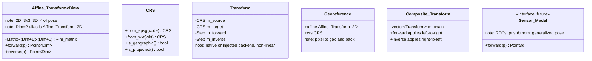

#  Coordinate Transformation Design

This document describes the coordinate transformation API implemented in `terminus_math`, supporting both math-based (pose/matrix) and coordinate-based (CRS/EPSG) transformations.

Related: `repos/terminus_image/docs/design/georeferenced_imagery.md` covers the image-level consumers (`reproject`, `Warped_Image_View`).

##  Requirements and Status

- A generalized coordinate projection pipeline
    - Support for multiple coordinate systems — implemented (`CRS` via EPSG/WKT)
    - Support for unique transformations — implemented (`Transform` native paths + injected backends)
    - Support for batch processing — pending (bulk `std::span` overload, task 3)
    - Support for parallel processing — pending (consumers thread the existing point API; the batch API is the enabler)

##  Core Design: Transform as the Common Abstraction

- A transform is an invertible point-to-point function:
    - `forward( p )` source -> target
    - `inverse( p )` target -> source (optional; needed for pull-model warping)
- Two implementation families conform to the same interface:
    - **Coordinate transforms** (CRS-based): EPSG codes / WKT, backed by PROJ or GDAL `OGRCoordinateTransformation`. Arbitrary, non-linear (datums, projections, grids).
    - **Math transforms** (pose/matrix): closed-form and exactly invertible. 3x3 affine for 2D raster work; 4x4 homogeneous for 3D poses.
- Note: a geotransform already IS an affine matrix (`gt[6]` = 3x3). Image transforms are covered by this same interface.
- Transforms compose into a `Composite_Transform` chain.
- No mandatory geospatial backend dependency in this library. CRS-transform *implementations* (PROJ/GDAL) live in an adapter; `terminus_math` owns the interface, the math transforms, and the coordinate value types.  This is realized today: `Transform::create` resolves native closed-form pairs (geographic <-> ECEF, geographic <-> UTM — hemisphere-correct per the target CRS's declared hemisphere) and `create_with_backend` accepts injected steps for everything else.

###  2D and 3D Support

- Both variants required. Most operations keep elevation as a pass-through:
    - 3D point transforms where z is copied untouched through 2D steps (e.g., horizontal datum shifts that don't model height).
    - Default policy: transforms declare whether they consume/produce z; pass-through unless explicitly elevation-aware.
- 4x4 matrices cover 3D poses (ECEF, sensor models); 3x3 covers 2D raster/frame work.

###  Sensor Models and Future-Proofing

- A pose is the simplest sensor model: position + orientation mapping image coordinates to object space. RPCs (NITF, pushbroom) and other parametric sensor models are the generalized variant — same role, richer parameterization.
- All conform to the `forward`/`inverse` interface; the function-based design survives sensor-model support for free. Consider for a future iteration alongside 3D elevation-aware transforms.
- `tmns::geo::coord` already has the coordinate value types (geographic, UTM, ECEF) to build on.

##  CRS Components

What a `tmns::geo::CRS` must model:

| Component | Required | Notes |
|-----------|----------|-------|
| Identity | yes | EPSG code or `authority:code`; optional stored WKT for round-tripping arbitrary definitions |
| `CRS_Kind` | yes | `geographic`, `projected`, `geocentric` (ECEF), `vertical`, `compound` (h+v), `engineering` (local/grid — covers non-geographic CV frames) |
| Horizontal datum | yes | Reuse existing `tmns::geo::Datum` (ellipsoid params + `WGS84`/`GRS80`/`SPHERE` factories) |
| Vertical datum | type implemented | `Vertical_Datum` exists alongside the (horizontal) `Datum`: ellipsoidal height vs orthometric/geoid height (EGM96/EGM2008, NAVD88). Elevation-aware transforms remain future while `Elevation_Policy::PASS_THROUGH` covers most ops |
| Axes | yes | Count (2/3), order, units. Axis order must be *declared*, not assumed — EPSG:4326 is authority lat-lon but universally treated lon-lat (the GDAL `OAMS_TRADITIONAL_GIS_ORDER` footgun) |
| Projection method | optional | For `projected` kind only: method + parameters (Transverse Mercator zone/CM/false easting). Enables native closed-form transforms |
| Serialization | partial | `from_epsg` (4326/4978/UTM 326xx-327xx native) and `from_wkt` (keyword classification only — no full WKT grammar) implemented. `to_wkt` round-tripping and a general EPSG registry remain open |
| Area of use | future | Validity extent for the CRS |

**Opaque vs. modeled CRS** — adopted: **hybrid**. `CRS` stores an opaque identity (EPSG code or WKT) plus structured fast-path data (kind, datum, axes, projection params) for natively-known CRSs. `Transform::create` tries the native path first; arbitrary pairs require `create_with_backend`. Gets GDAL-independent rendering for Landsat-class inputs without reimplementing PROJ.

##  Class Model

##  Implemented Types

| Type | Namespace | Role |
|------|-----------|------|
| `CRS` | `tmns::geo` | CRS identity — EPSG code or WKT; factory methods only, no transform math itself. Domain-standard acronym (OGC/PROJ/GDAL) |
| `Transform` | `tmns::geo` | Point-to-point between two CRSs; `create` resolves native closed-form pairs (geographic <-> ECEF, geographic <-> UTM), `create_with_backend` injects an external adapter (PROJ/GDAL) |
| `conversions` | `tmns::geo::coord` | Closed-form `to_ecef`/`to_geographic`/`to_utm` between the native `coord` types — the math `Transform` dispatches to |
| `Affine_Transform<Dim>` | `tmns::math` | Thin wrapper over `Matrix<double,Dim+1,Dim+1>` — `Dim=2` is 3x3, `Dim=3` is 4x4; `Affine_Transform_2D`/`_3D` aliases. Adds `forward`/`inverse` point mapping and `from_geotransform`; `inverse` exploits the affine structure (`[A|t; 0|1]⁻¹ = [A⁻¹|−A⁻¹t; 0|1]`) with an epsilon-pivot check — the generic `math::inverse` does not reliably detect singular matrices |
| `Georeference` | `tmns::geo` | A pose (`Affine_Transform<2>` or `<3>`) paired with a `CRS` — pixel <-> geo in one object |
| `bounds.hpp` functions | `tmns::geo` | `raster_bounds` (affine-corner extent), `transform_edge_points` (densified-edge footprint ring — the reprojected polygon), `transform_bounds` (densified-edge extent, `rasterio.transform_bounds` analog), `calculate_default_georeference` (resolution-preserving output pose + size, returns `Derived_Georeference`) |
| `Composite_Transform` | `tmns::math` | Ordered chain of type-erased transform steps; `forward` left-to-right, `inverse` right-to-left |
| `Elevation_Policy` | `tmns::math` | Enum: `pass_through` (default), `consume`, `produce` — declares z handling per transform |
| `Vertical_Datum` | `tmns::geo` | Height reference — ellipsoidal vs orthometric (geoid models: EGM96/2008, NAVD88). Companion to horizontal `Datum`; required for 3D/compound CRSs |
| `CRS_Kind` | `tmns::geo` | Enum: `geographic`, `projected`, `geocentric`, `vertical`, `compound`, `engineering` |
| `Axis_Set` | `tmns::geo` | Declared axis count/order/units — resolves the lat-lon vs lon-lat ambiguity explicitly |
| `Sensor_Model` | `tmns::geo` | Interface stub — `to_object`/`to_image` plus object-CRS binding; RPCs/pushbroom as generalized poses |
| `Point_Transform` | `tmns::geo` | `std::function<Result<Point2d>(Point2d)>` alias — direction-bound geo-space map injected into the bounds functions and image warp layer |

##  Tasks

1. [ ] EPSG registry/lookup beyond the natively-known codes (4326, 4978, 326xx/327xx) — or accept WKT-only until a backend lands; richer `from_wkt` parsing (keyword classification today) and `to_wkt` round-tripping
2. [ ] Native UTM <-> ECEF path (currently requires geographic as an intermediate; compose or add direct dispatch in `Transform::create`)
3. [ ] In-place bulk transform: `forward`/`inverse` overloads taking a mutable `std::span<PointT>` (or parallel ranges) — per-point `Result` doesn't scale for image-sized batches (millions of pixels); batch API should be SIMD/threads-friendly, zero-copy, single failure flag
4. [ ] Investigate pre-existing matrix/linalg failures (`linalg_operations.rank_and_nullspace`, `Matrix_Operations.matrix_multiplication_*_blended`) — `inverse()` does not reliably detect singular matrices; surfaced by the new `Affine_Transform` tests
